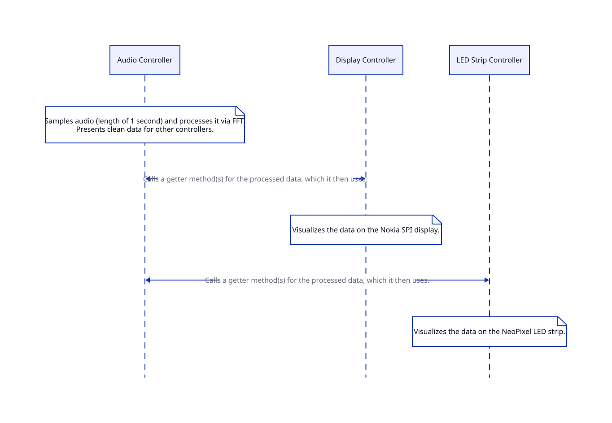

# MicroPython project running on RP Pico W for the BPC-DE2 26/27Z, BUT FEEC

## Task and motivation

Create an audio spectrum analyzer utilizing a microphone module, SPI
display module an a NeoPixel LED strip.

## Audio Spectrum Analyzer

### Hardware wiring


|   RP Pico W   | Micorphone Module (MAX4466) |
|:-------------:|:---------------------------:|
|      3V3      |             VCC             |
| GPIO26 (ADC0) |             OUT             |
|     AGND      |             GND             |

| RP Pico W | Nokia 5110 Module |
|:---------:|:-----------------:|
|   3.3V    |        VCC        |
|    GP2    |        RST        |
|    GP3    |        CS         |
|    GP4    |        D/C        |
|   GP11    |        DIN        |
|   GP10    |        CLK        |
|   3.3V    |        VCC        |
|   GP15    |        BL         |
|    GND    |        GND        |

| RP Pico W | NeoPixel LED Strip |
|:----------|--------------------|
| GP16      | DATA               |

External 3.3V power supply will be used for powering the LED Strip. It
will share GND with the RP Pico W for common ground.

### Modules used

| Module name                  | Documentation                                                                                  |
|:-----------------------------|------------------------------------------------------------------------------------------------|
| MAX4466 Microphone module    | [doc](https://www.analog.com/media/en/technical-documentation/data-sheets/MAX4465-MAX4469.pdf) |
| Nokia 5110 module            | [doc](https://cdn.sparkfun.com/assets/b/1/b/e/f/Nokia5110.pdf)                                 |
| NeoPixel Strip (WS2812 LEDs) | [doc](https://www.alldatasheet.com/datasheet-pdf/pdf/1179113/WORLDSEMI/WS2812B.html)           |


### Diagram of a proposed main loop of the program



So far, we don't expect any "user input". This is so far a simple main
loop where we sample data (which is a blocking process, since it needs
to continuously sample the data for the given duration of the sampling
time) and then process it by other modules. 

### Tooling and micropython libraries in use

TODO: Specify Micropython version used

For tooling the command line tool
[mpremote](https://docs.micropython.org/en/latest/reference/mpremote.html)
is used, as well as the [Thonny IDE](https://thonny.org/).

#### Libraries in use so far:

- [MicroPython PCD8544](https://github.com/mcauser/micropython-pcd8544)
- [Micropython built-in neopixel library](https://docs.micropython.org/en/latest/library/neopixel.html)

### Proposed code organization

- Decoupled modules, with clean APIs
- Documentation in code of classes, methods, functions
- Clean main loop
- If a module uses multiple source files it should have a dedicated directory under /src

### Roles of team members

The specific roles might change, or team memebers chould work, help and
contribute to other parts of the project, as time goes on. 

- Jan Pánik: Implementation of Audio module
- Matěj Berger: Implementation of Display module
- Daniel Kubica: Implementation of LED controller module and administration of the git repository

### Directory structure

```
├── readme_assets 
└── src
    ├── hardware_modules_test_scripts
    └── lib
```
	
Source code will be stored inside `/src`. `/src/lib` is for external
libraries, like the MicroPython Nokia 5110 PCD8544 84x48 LCD driver
library (`/src/lib/pcd8544.py`). `/src/hardware_module_test_scripts`
stores testing scripts for the various hardware modules.

### Checklist

Week 1:
- [x] Initial repo structure
- [x] Defined team memebr roles
- [x] Wiring proposal and library use

Week 2:
- [x] Testing of hardware modules
- [x] Updated wiring/software diagrams
- [ ] Initial class structure/APIs

Week 3:

---

Authors: Jan Pánik, Matěj Berger, Daniel Kubica 

