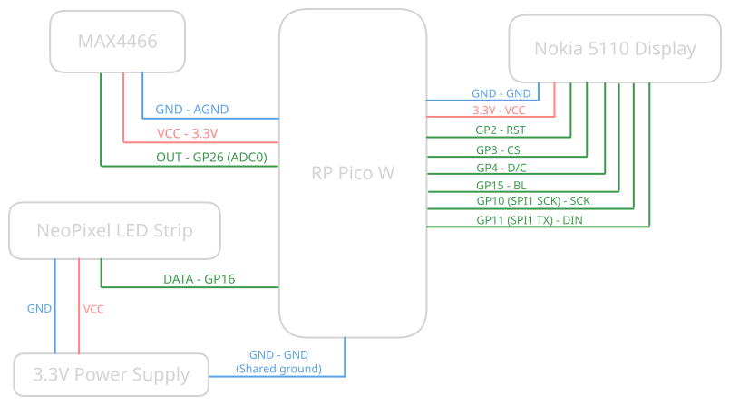

# MicroPython project running on RP Pico W for the BPC-DE2 26/27Z, BUT FEEC

Authors:

- Daniel Kubica
- Jan Pánik
- Matěj Berger

## Task

Create an audio spectrum analyzer utilizing a microphone module, SPI display module an a NeoPixel LED strip.

## Audio Spectrum Analyzer

### Hardware wiring

|   RP Pico 2   | Micorphone Module |
|:-------------:|:-----------------:|
|      3V3      |        VCC        |
| GPIO26 (ADC0) |        OUT        |
|     AGND      |        GND        |

| RP Pico 2 | Nokia 5110 Module |
|:---------:|:-----------------:|
|   3.3V    |        VCC        |
|    GP2    |        RST        |
|    GP3    |        CS         |
|    GP4    |        D/C        |
|   GP11    |        DIN        |
|   GP10    |        CLK        |
|   3.3V    |        VCC        |
|   GP15    |        BL         |
|    GND    |        GND        |

| RP Pico 2 | NeoPixel LED Strip |
|:----------|--------------------|
| GP16      | DATA               |

External 3.3V power supply will be used for powering the LED Strip. It
will share GND with the RP Pico 2 for common ground.

### Proposed micropython libraries in use

- [MicroPython PCD8544](https://github.com/mcauser/micropython-pcd8544)
- [micropython-fourier](https://github.com/peterhinch/micropython-fourier)
- [Micropython built-in neopixel library](https://docs.micropython.org/en/latest/library/neopixel.html)

### Proposed code organization

- Decoupled modules, with clean APIs
- Documentation in code of classes, methods, functions
- Clean main loop
- If a module uses multiple source files it should have a dedicated directory under /src

### Roles of team members

The specific roles might change, or team memebers chould work, help and
contribute to other parts of the project, as time goes on. 

- Jan Pánik: Implementation of Audio module
- Matěj Berger: Implementation of Display module
- Daniel Kubica: Implementation of LED controller module and administration of the git repository

