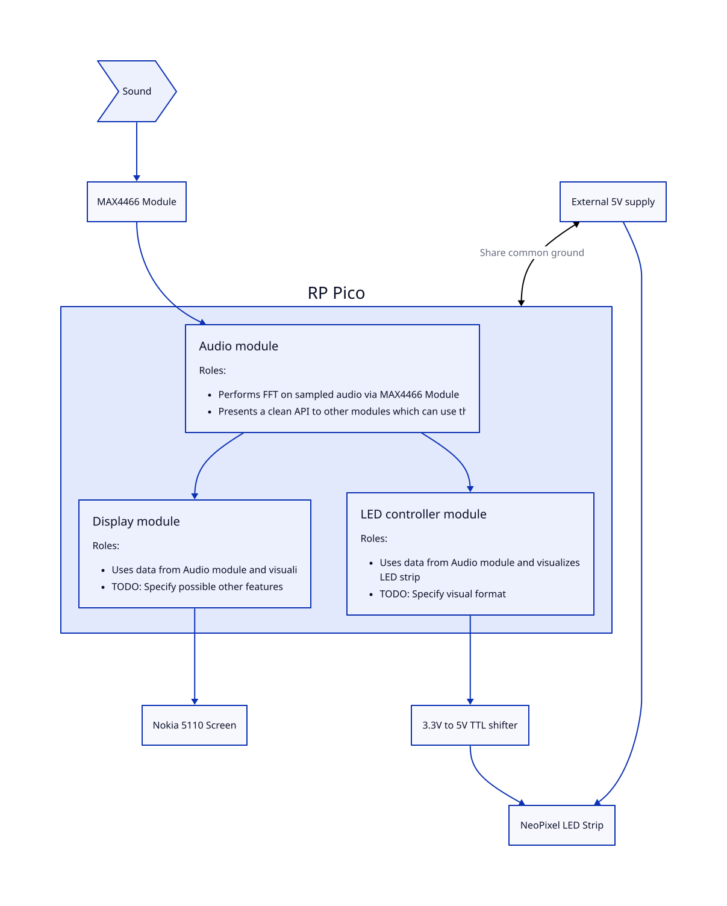

# MicroPython project running on RP Pico W for the BPC-DE2 26/27Z, BUT FEEC

Authors:

- Daniel Kubica
- Jan Pánik
- Matěj Berger

## Task

Create an audio spectrum analyzer utilizing a microphone module, SPI display module an a NeoPixel LED strip.

## Audio Spectrum Analyzer

### Hardware/software diagram

### Proposed wiring

|   RP Pico   |Micorphone Module|
|:-----------:|:---------------:|
|     3V3     |       VCC       |
|GPIO26 (ADC0)|       OUT       |
|     GND     |       GND       |

|RP Pico|Nokia 5110 Module|
|:-----:|:---------------:|
| 3.3V  |       VCC       |
|  G2   |       RST       |
|  G3   |       CE        |
|  G4   |       D/C       |
|  G5   |       DIN       |
|  G6   |       CLK       |
|  G7   |       VCC       |
|  GP8  |       BL        |
|  GND  |       GND       |

One GPIO pin will be used for the Din (Data pin) of the NeoPixel LED
Strip.  First going through a level shifter 3.3V -> 5V logic, since
usually these types of LED strips expect a 5V logic signals.

### Proposed micropython libraries in use

- [MicroPython PCD8544](https://github.com/mcauser/micropython-pcd8544)
- [micropython-fourier](https://github.com/peterhinch/micropython-fourier)
- [Micropython built-in neopixel library](https://docs.micropython.org/en/latest/library/neopixel.html)

### Proposed code organization

- Decoupled modules, with clean APIs
- Documentation in code of classes, methods, functions
- Clean main loop
- If a module uses multiple source files it should have a dedicated directory under /src

### Roles of team members

The specific roles might change, or team memebers chould work, help and
contribute to other parts of the project, as time goes on. 

- Jan Pánik: Implementation of Audio module
- Matěj Berger: Implementation of Display module
- Daniel Kubica: Implementation of LED controller module and administration of the git repository

